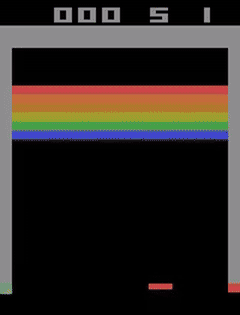

# Deep Q-Learning on Atari Breakout

Training a Deep Q-Network to play Breakout from raw pixels, with a six-run study of how replay buffer size, exploration and discount factor affect learning stability.

> Lab 4 of *Advanced Deep Learning (D7047E)*, Luleå University of Technology, spring 2024. Group 7; see [Team](#team).



*The run A agent at its best checkpoint (episode 5,000, score 59).*

## Setup

- **Environment:** `BreakoutNoFrameskip-v4` (Gym / Atari) with standard frame preprocessing
- **Agent:** DQN with experience replay and a target network (updated every 1,000 steps), built on Stable-Baselines3 components
- **Baseline hyperparameters:** learning rate 1e-4, γ = 0.99, batch size 32, ε decaying from 1.0 to 0.01, learning starts at 80k steps, train every 4 steps

## Experiments

| Run | Change from baseline | What happened |
|---|---|---|
| A | Buffer 100k (memory limit) | Peaked at a score of 59, then collapsed into a poor policy |
| B | Buffer 200k, exploration fraction 0.2, final ε 0.05 | Sudden catastrophic forgetting around step 175k |
| C | Buffer 250k | Reached higher returns than A, but instability returned around step 1.65M |
| D | As C, exploration fraction 0.33 | Learned far too slowly (rolling return about 5 vs 45 for A) |
| E | As C, exploration fraction 0.08 | Learned faster, still unstable |
| **F** | **Buffer 400k, γ = 0.95, batch 128, exploration 0.05** | **Most stable: steady upward trend, no catastrophic forgetting** |

Hyperparameters for each run are in `notebooks/hyperparams_A.py` to `hyperparams_F.py`, gameplay videos are in [`videos/`](videos), and the training curves are in [`results/training_plots.xlsx`](results/training_plots.xlsx).

## Takeaways

- **Replay buffer size drives stability.** Small buffers let the agent overfit to recent experience and forget earlier skills; 400k transitions gave the smoothest learning.
- **A shorter horizon helps here.** Lowering γ from 0.99 to 0.95 reduced the variance of the value targets.
- **Exploration is a balancing act.** Too much (run D) wastes millions of steps; too little (run E) speeds early learning but doesn't fix instability.
- **Cost matters.** Run F needed several days on a laptop to reach about 4.5M steps and 5,000 episodes.

## Running it

```bash
pip install "gym[atari,accept-rom-license]" stable-baselines3 torch numpy jupyter
jupyter notebook notebooks/dqn_breakout_experiments.ipynb
```

The theory part of the lab (Q-learning by hand) is in [`notebooks/theory_tasks.ipynb`](notebooks/theory_tasks.ipynb) and [`docs/theory.pdf`](docs/theory.pdf).

## Team

Group 7, D7047E Advanced Deep Learning: **Aamer Barood** and teammates. The original group repository, with full commit history, is [Gabmyr/D7047E-Labs-Group-7](https://github.com/Gabmyr/D7047E-Labs-Group-7).
